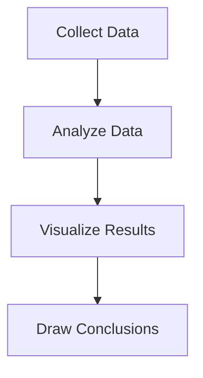

# 👩‍💻 Women in Technology

## 📌 Project Overview

This project explores women's representation in the technology sector.

**Objective:** Understand gender representation across different regions.

## 📊 Data

The following data is fictional and used for demonstration purposes.

| Region | Women (%) |
|---|---:|
| Europe | 25 |
| Asia | 22 |
| America | 30 |

## 🧮 Statistical Example

The average representation is calculated using the arithmetic mean:

$$
\bar{x} = \frac{25 + 22 + 30}{3} = 25.67\%
$$

## 🔄 Analysis Process

## 💡 Key Findings

- America has the highest representation (30%).
- Asia has the lowest representation (22%).
- The average is 25.67%.

## 📝 Conclusion

Data analysis helps us understand gender representation
and identify opportunities for improvement.

---

**Tools:** Markdown | LaTeX | Mermaid | GitHub

